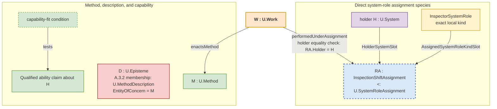

# A.15 - System-Role–Method–Work Alignment {#root}

<status stage="spec" state="done"/>

> Source: Anatoly Levenchuk, *First Principles Framework (FPF) - Core Conceptual Specification* (September 2026), `FPF-Spec.md` at https://github.com/ailev/FPF commit d131d30a44e7, licensed CC BY 4.0. Working sections of the pattern; its depth sections live in the source document named by the last line. See LICENSE.md for the list of changes.

> **Type:** Architectural (A)
> **Status:** Stable
> **Normativity:** Normative unless marked informative

**At a glance.** Use this pattern when a team must say which System performed which Work, under which assignment, which Method the Work enacted, and which plan applied without confusing any of those values with a description, capability, record, or result. A precise actual-performer branch first reuses A.13's core, then A.15.1 independently admits the dated Work, and only afterward F.6 uses the same obtaining assignment when precise assignment-bound attribution is current; an agency characteristic profile remains conditional on its receiving use.

**Use this when.** Separate a local system-role kind, an assignment occurrence that obtains, its holder system, a `U.Method`, any `U.MethodDescription`, a `U.WorkPlan`, a qualified ability claim about the holder, the capability-fit and evidence claims actually relied on, and dated Work before a schedule, display, document, or familiar label is treated as if it established the whole chain.

**Start here when.** The team is mixing system classification or assignment with recipe, schedule, capability, or performed Work, often under an ambiguous source word such as *role*, *process*, *workflow*, or *activity*.

**First output.** If the team is planning, name the intended `U.WorkPlan`, intended performer System, local system-role kind, and Method needed by the next decision; do not invent Work or an obtaining assignment. If performance has occurred, first recover the A.13 core and independently admit the dated Work under A.15.1 from its actual history, Method, extent, and containing-System relation. Then, only when precise assignment-bound attribution is current, establish F.6 `performedUnderAssignment` through the same obtaining assignment. Name only the assignment occurrence, declared species, holder System, and Method needed by this decision. Say plainly that the A.13-qualified holder System performed the Work under that same assignment and that the Work enacted the Method only when both relations obtain. Keep the local system-role kind, MethodDescription, WorkPlan, capability, assertions, records, and results separate in either branch.

**Working enactment-alignment sequence.** For precise actual performance, recover the A.13 core for the holder System and local agential kind -> recover the same obtaining assignment occurrence and its declared species -> separate Method from MethodDescription, WorkPlan from Work, and capability from performance -> independently admit the dated Work through A.15.1 -> apply F.6 only when precise assignment-bound attribution is current -> state only the relations needed by the next use -> proceed, plan, probe, narrow, use the pattern for another claim, or stop.

**Working alignment applications.**

1. For a precise actual-performer claim, recover the exact holder System, the local agential system-role kind and criterion, classification, same obtaining assignment, scope, working situation, window, and adequate A.13 core evidence. Add a characteristic profile only when a Grade, autonomy or profile result, criterion-dependent characteristic, or assurance use consumes it.
2. Name the declared assignment species and the occurrence that actually obtains. The species defines the holder and assigned-kind positions; the occurrence supplies their actual values. Add another participant only when it changes the assignment.
3. Name the Method and keep any MethodDescription separate. Name the intended `U.WorkPlan`, the actual dated Work occurrence, or both as the claim requires; never use one as proof of the other.
4. State `performedUnderAssignment` and `enactsMethod` only when their predicates obtain. The holder system performs the Work; neither the kind, assignment, Method, description, plan, nor capability acts.
5. If a visible item is being relied on for a Work, approval, evidence, gate, or release claim before the relation required by that claim is known, use `A.15.4`; keep only the alignment part here.

**Minimum sufficient use.** Recover only the values and relations needed by the receiving use. Ordinary orientation can stop at one clear sentence. A reliance-bearing claim may also need exact occurrence identity and extent, the selected source and its currentness, a capability-fit claim, and the evidence or assurance claim actually relied on.

**Recovered-reference sufficiency condition.** Proceed when every project-side value on which the claim relies is identified by its admitted kind, exact referent, scope, and current window. Otherwise narrow the claim, run a bounded reversible probe, recover the missing relation, or create only the smallest repair request, decision request, prospective WorkPlan entry, or missing-source note needed for the next use.

**Ordinary use.** “Robot-7 performed InspectionWork-17 under InspectionAssignment-17, and the Work enacted TurbineInspectionMethod” can be enough when the A.13 core, same obtaining assignment, F.6 link, and `enactsMethod` relation remain recoverable and the receiving use needs no additional identifiers. A Grade or autonomy profile is not implied.

**Reliance-bearing use.** Use the fuller frame when assignment identity, assignment state, Method edition, capability fit, plan baseline, approval, evidence, release, or disputed responsibility changes the decision. Responsibility and authority remain separate direct relations; neither follows from a system-role kind or assignment.

**Stop condition.** Stop once the separation changes no next admissible use and blocks no concrete overclaim about classification, assignment, assignment state, Method, plan, Work, result, approval, evidence, or release.

**Admissible-use examples.**

| Admissible project use | Source-finding or reversible probe | Non-admissible use |
| --- | --- | --- |
| A maintenance team identifies `PumpInspectorSystemRole`, the direct `MaintenanceInspectionAssignment` species and current occurrence, the inspection Method and its MethodDescription, and the current `U.WorkPlan`. After inspection, it identifies the dated Work occurrence and a separate inspection record. | A briefing says inspection is ready, but the MethodDescription, plan, or assignment occurrence is missing; use the briefing only to locate or repair that source before reliance. | A dashboard tile, copied approval, generated explanation, role label, or briefing is treated as the assignment, Method, WorkPlan, performed Work, or execution evidence. |

**Alignment frame in plain terms.** The system-role kind says what contribution kind is in question. The assignment relates this system to that kind in one actual episode. The Method is the way the Work is done. The WorkPlan says what is intended. The dated Work occurrence is what happened. Descriptions and records state claims about those values; they are not those values.

**What goes wrong if missed.** A team collapses classification, assignment, recipe, plan, capability, and performed Work into one fuzzy “process” or “role” label, then mistakes documentation for execution, capability for performance, a schedule for an occurrence, or an assignment for responsibility.

**What this buys.** A compact trace that answers who performed the Work, under which assignment, which Method the Work enacted, and which separate plan and evidence applied, while leaving every stronger neighboring claim to its direct pattern.

**Not this pattern when.** Use `A.15.1` for one dated Work occurrence, `A.15.2` for planning or schedule baselines, `A.15.5` for work-entry readiness, `A.16` or `A.16.1` for a cue that has not become an alignment question, `A.6` or `A.6.B` for boundary or policy wording, `E.10.ROLE` when *role* is still unresolved, and `A.15.4` when a visible item is being relied on by appearance.

**Related pattern contributions.** Use `A.2` and C.3 to identify exact local system-role kinds, `A.2.1` for direct `U.SystemRoleAssignment` species, A.13 for the precise local agency core and any conditionally consumed profile, `F.6` for performed-Work attribution through that same assignment, `A.15.1` for dated Work, `A.15.2` for WorkPlan epistemes, `A.15.3` for declaration-local planned-filling content inside a WorkPlan, `A.15.4` for work-relevant reliance by appearance, `A.15.5` for work-entry readiness, `F.11` to align Method and Work vocabulary across contexts, and `F.17` for the human-facing term sheet.

**Causal-use work boundary.** Counterfactual sampling, randomization, intervention assignment, target-trial emulation, and causal evidence collection can be represented here as Methods, MethodDescriptions, WorkPlans, dated Work occurrences, and their exact assignment and Method relations. A.15 does not make the resulting causal use admissible. Use `C.28` for the causal-use question, rung, estimand, separate evidence/identification/estimate/sampling/simulation components, counterfactual-sampling result, support result, and supported and unsupported uses.

**Related-record mistakes.** A cue, publication, plan, record, result, evidence item, or approval can help locate a value without becoming that value. Recover the dated Work under `A.15.1`. State a subject-specific production or result relation only under its direct pattern; for a production-work, entity-inception, or production-completion question, A.15.PROD may instead return one local claim or exact blocker. Use `A.15.4` only when reliance on an encountered appearance is the problem.

**Boundary to coarsened renderings.** A briefing, summary, redacted note, or coarsened rendering may orient work. Rely on it for an execution, approval, gate, or evidence question only when the exact sources and relations required by that use remain explicit and reopenable. Use `A.6.3.CSC` when coarsening itself changes what may be relied on.

**Outside-practice result boundary.** When one receiving decision or piece of Work needs a bounded result governed by another practice, use `A.15.9` to inspect an already-available result before requesting anything new, ask only for the remaining gap, and preserve supplier Method and authority separately from the receiving decision. A.15 keeps the underlying Method, Work, performer, assignment, communication, result, and record distinctions unchanged.

## A.15:1 - Problem frame {#problem-frame}

When the alignment is already clear and ongoing Work still needs one next action chosen from current facts within an applicable domain Method, use `A.15.7`. It keeps the domain Method, steering Method, deciding System, intended performer, and any later WorkPlan or performed-action claim separate.

Complex work requires several independent distinctions: what a System is; which local system-role kind classifies it; which assignment occurrence obtains and which declared `U.SystemRoleAssignment` species it instantiates; how Work is done through `U.Method`; whether an episteme is a `U.MethodDescription`; which holder capability is relied on; what `U.WorkPlan` states; which dated Work happened; and which separate assertions, records, results, and evidence concern that Work.

A.15 brings these already defined values together without creating a new process object or redefining their ontologies:

* **A.2 and C.3** identify a local system-role kind and any classification judgment. Classification neither creates an assignment nor proves Work.
* **A.2.1** identifies an assignment occurrence and its declared species under `U.SystemRoleAssignment`. The species declares `HolderSystemSlot`, a declaration-local `AssignedSystemRoleKindSlot` with its local system-role-kind domain, its predicate and applicability, any additional participants, and its occurrence-identity rule. The occurrence supplies the actual participants and extent. Taxonomy, scheme, signature, assertion, evidence, and interval may interpret or describe the claim; they are not generic participants.
* **A.13, A.15.1, and F.6** govern ordered but distinct results. A.13 supplies the exact System, local agential kind and criterion, classification, obtaining assignment, scope, working situation, window, and adequate core evidence; its characteristic profile is conditional. A.15.1 then independently admits dated Work. Only after admission, and only when the receiving use expressly consumes precise assignment-bound attribution, does F.6 relate that Work to the same assignment through `performedUnderAssignment`. Its holder projection is used only to compare holder equality with the actual performer already recovered through A.13; F.6 identifies neither assignment nor performer. Missing F.6 attribution does not revoke Work membership.
* **A.3.1 and A.3.2** keep `U.Method` distinct from `U.MethodDescription`.
* **A.15.1 and A.15.2** keep actual dated Work distinct from intended WorkPlan and from every record about either.
* **A.2.2, A.10, and neighboring direct patterns** keep capability-fit claims, evidence use, source currentness, publication, responsibility, authority, access, results, and assurance outside assignment and Work identity.

Use `E.10`, `E.10.ARCH`, and `E.10.ROLE` when source wording such as *process*, *workflow*, *action*, *activity*, *schedule*, or *role* has not yet been resolved. The wording chooses no FPF object by itself. Recover the exact Method, MethodDescription, WorkPlan, Work, Transformation, Dynamics, evidence, gate, source, publication use, participation relation, declaration slot, or ordinary non-technical use that the claim actually needs.

## A.15:2 - Problem {#problem}

Without this alignment, several category errors recur:

1. **System-role-kind as part.** `AuditorSystemRole` is placed in structural `partOf` decomposition although it is a local kind used to classify systems.
2. **Description as execution.** A recipe, algorithm, SOP, or MethodDescription is treated as proof that Work occurred.
3. **Capability as Work.** Ability and actual performance are collapsed.
4. **Incomplete Work basis or attribution.** A Work claim lacks its required performer, assignment, or Method basis, or a precise assignment-bound attribution claim lacks its holder-equality check.
5. **Assignment as responsibility or authority.** Holding a system-role assignment is treated as if it established a duty, permission, responsibility, authority, or approval relation.
6. **Universal assignment record.** A permissive root signature hides different direct species and turns taxonomy, scheme, context, or source into generic participants.
7. **Actor by association.** A kind, assignment, capability, Method, description, plan, or record is made to act. Only the admitted holder system performs Work.
8. **Process soup.** One overloaded source word stands for classification, assignment, Method, description, plan, Work, result, and record at once.

## A.15:3 - Forces {#forces}

| Force | Tension |
| --- | --- |
| Structure and enactment | Stable structural decomposition must remain distinct from system classification, assignment, Method, plan, capability, and dated Work. |
| Simple and specialized assignments | A simple assignment should remain light, while a real commission, position, or locus must retain the participant that distinguishes its species and occurrence. |
| Method, plan, and occurrence | A reusable Method, its description, intended Work, and performed Work must stay connected without becoming one record. |
| Clarity and precision | Practitioners need ordinary readable claims, while reliance-bearing use may need exact occurrence identity, evidence use, source currentness, or assurance. |
| Accountability and proportionality | Auditability may require a full trace, but ordinary orientation should stop at the shortest sufficient relation chain. |

## A.15:4 - Solution {#solution}

Recover the actual values first, then state only the relations needed by the receiving use. A.15 aligns system-role kind, assignment, Method, MethodDescription, capability, WorkPlan, Work, and separate records; it does not create a universal process object or a universal assignment signature.

When source wording points to changing, producing, selecting, deriving, controlling, or maintaining an `EntityOfConcern`, use `E.10.ARCH` to recover the object. A workflow graph, process calculus, matrix, category, embedding, or neural representation may describe or serve as a lens over a Method relation structure; it is not automatically a Method, assignment, WorkPlan, or Work occurrence.

### A.15:4.1 - Core entities kept distinct {#core-entities-kept-distinct}

* **Exact local system-role kind.** A value such as `InspectorSystemRole : U.Kind` is admitted under A.2 with C.3 through its `U.System` candidate domain, operative work-facing membership condition, member/non-member boundary, and continuity rule. It is not a system, assignment, relation slot, capability, Method, Work, responsibility, or authority. A system classification judgment and an assignment occurrence are separate claims.
* **`U.SystemRoleAssignment`.** This is the relation family consumed by A.15 and F.6. It has no permissive root `RelationSignature`. Each direct species declares `HolderSystemSlot : U.System`, a declaration-local `AssignedSystemRoleKindSlot` whose ValueKind is one exact local system-role-kind domain, its predicate and applicability, every real additional participant, and its occurrence-identity rule.
* **`U.Method`.** The run-independent semantic way of doing. A Work occurrence can stand in `enactsMethod(W, M)`; the Method does not act.
* **`U.MethodDescription`.** An already identified `U.Episteme` whose exact `EntityOfConcern` is an admitted Method and whose substantive claims say how that Method is done, as judged by A.3.2. Wording, file form, or publication alone establishes no membership.
* **Holder capability (A.2.2).** The holder's ability to perform named work under stated conditions and bounds. Its assertion, evidence, currentness assessment and fit to a demand remain separate. Ability establishes neither assignment nor performed Work.
* **`U.WorkPlan`.** A `U.Episteme` about possible future Work, including intended windows, dependencies, performers, and budgets. It does not bring a future Work occurrence into existence.
* **`U.Work`.** The admitted kind for concrete dated Work occurrences. One Work individual has its own temporal extent, at least one obtaining A.15.1 `enactsMethod` relation, and at least one obtaining locally declared containing-system relation. It may stand in further enactment, affected-referent, binding, resource-use, production, and result relations when the receiving use needs those independently obtaining facts. Any log, ticket, assertion, description, or performed-work record is a separate episteme.

**Work occurrence and record boundary.** Do not add a universal `primaryTarget` field, a local `kind` field, or an Operational, Communicative, and Epistemic enumeration to Work identity. Recover the exact affected-referent, transformation, speech-act effect, commitment effect, production, delivery, acceptance, or other relation under its direct pattern. Those adjectives can remain recognition cues; they do not define Work subkinds by enumeration.

**Didactic note for managers: the chef analogy.** `ChefSystemRole` is one local system-role kind. A kitchen-assignment species defines the holder and assigned-kind positions and adds shift, station, or commission only when it changes the assignment. A particular assignment fills those positions with the chef System, the kind, and any additional value. A cookbook can be a MethodDescription; the chef's skill can be a capability; a WorkPlan can schedule cooking; and making one souffle on Tuesday is dated Work. Its temporal and resource-use relations can state the 25-minute extent, eggs, butter, and consumed gas, while a kitchen log remains a separate episteme. A restaurant vocabulary or scheme can help interpret the claims without becoming a participant in every assignment. The cookbook, skill, plan, assignment, and log do not cook.

### A.15:4.2 - Canonical relations {#canonical-relations}

The diagram shows a simple direct assignment species. A stronger appointment can declare a real additional participant such as a review commission; that specialized occurrence itself is the `U.SystemRoleAssignment`. Do not create a weaker generic occurrence beside it.

* **Capability fit.** A MethodDescription, WorkPlan, or work-admission assertion may require a holder capability threshold. The fit condition compares the holder's qualified ability claim with the receiving work conditions and bounds and may cite declared measures, `U.Characteristic` values, Q-Bundle slots, or architecture-characteristic criteria. It is neither an assignment participant nor a second capability kind.
* **MethodDescription membership.** `D` is a `U.MethodDescription` only when A.3.2 recovers Method `M` as its exact EntityOfConcern and at least one substantive way-of-doing claim. “D describes M” is shorthand for that constitution and membership result, not another binary relation.
* **`enactsMethod(W : U.Work, M : U.Method)`.** This relation states which exact Method the dated Work enacts. A.15.1 defines its participant order, predicate, occurrence identity, and multiplicity. It neither attributes a performer nor turns a description into the Method.
* **`performedUnderAssignment(W : U.Work, RA : U.SystemRoleAssignment)`.** F.6 defines this relation. For a precise actual performer, `RA` is the same obtaining assignment used by A.13 for the exact action, scope, working situation, and window. It must be an occurrence of a declared assignment species, have the A.13-qualified System as holder, and cover the Work while the species predicate obtains. The assignment is the attribution ground, not the actor. A record may state the relation without constituting it. Read an existing `performedBy(W, RA)` claim only through the F.6 compatibility boundary after resolving the holder System; do not author new claims with that spelling.

One assignment occurrence continues through the maximal uninterrupted interval in which its direct species predicate obtains for fixed participants. A declared interval, taxonomy, scheme, KindSignature, assertion, evidence item, or selected model-use structure can describe or interpret the claim but does not create the occurrence or become a generic participant.

For a precise performed occurrence, first recover the A.13 core for the exact actual performer System and action, then admit `W : U.Work` under A.15.1 from its independent occurrence, Method, extent, and containment facts. Only afterward trace `W` to the same `RA` through F.6 `performedUnderAssignment` when the receiving use needs precise assignment-bound attribution, and compare `RA.HolderSystemSlot` with the already recovered performer; F.6 identifies neither. Trace `W` to `M` separately through `enactsMethod`. Cite a characteristic profile only when conditionally consumed; cite a MethodDescription, plan, capability claim, evidence item, taxonomy, or scheme separately only when the receiving use relies on it. The performer System acts; the kind, assignment, capability, Method, description, plan, evidence, and record do not.

### A.15:4.3 - Bounded specialization scouting and `CheckpointReturn` {#bounded-specialization-scouting-and-checkpointreturn}

When one human-plus-AI pair faces a new task or solution family, identify each participating human or AI service as an admitted System before using this alignment. The pair may use four local system-role kinds for this bounded work: `OutcomeCriterionHolderSystemRole`, `AIScoutSystemRole`, `AISpecialistProbeSystemRole`, and `CommitAuthoritySystemRole`. Claim an assignment only by naming its occurrence and declared species under `U.SystemRoleAssignment`. The `CommitAuthoritySystemRole` name does not supply decision authority; any authority relation must obtain independently.

First distinguish the probe's question. If another probe could change which option survives the `OptionSet`, return to C.11. If changed live facts or domain-Method limits could change the next action during ongoing Work, return to A.15.7. Use the enactment checkpoint below only when the action or option is fixed, tool or service calls must be planned, and route shape or rollout order is uncertain.

The pair declares one outcome criterion, explores several candidate routes for that fixed action or option, spends a bounded scouting or probing budget before commitment, and returns one `CheckpointReturn` comparing the tested routes. Keep scouting budget, probing budget, and commit checkpoint distinct. Use A.15 only for this dyadic assignment, Method, plan, and Work alignment; use C.24 for checkpoint-record semantics and E.16 for budget and guard enforcement.

Every `CheckpointReturn` carries:

- the declared outcome criterion and current `TaskFamily`;
- the candidate approaches actually tested;
- evidence observed for each tested approach, including progress toward the work-measure threshold and important failure signals;
- burned and residual budget;
- the recommended next use: continue probing, commit to planned Work, narrow the Method or claim, use the direct pattern for another claim, or stop; and
- the commit trigger that would justify leaving the bounded probe.

The return is evidence about candidate approaches, observed results, budget, and the commit trigger. It is not the selected Method, `U.WorkPlan`, or actual Work. Execution-evidence, provenance, and rollout-decision claims need their own admitted values and relations before committed rollout.

Low-human-overlap approaches remain admissible here only while they stay tied to the outcome criterion, budget limits, and the exact evidence or provenance relation used by the receiving claim.

### A.15:4.4 - Boundary to A.15.4 Work-Relevant Appearance-Based Reliance Repair {#boundary-to-a-15-4-work-relevant-appearance-based-reliance}

Use `A.15.4` when an encountered episteme, carrier, display, credential view, generated explanation, copied statement, provenance mark, dashboard tile, schema wording, API wording, or source-relation chain is being relied on by appearance for Work, assignment currentness, assignment state, source currentness, approval, authorization, gate passage, evidence, engineering justification, release, or another reliance-bearing claim.

A.15 itself keeps the exact local system-role kind, holder system, direct assignment occurrence, Method, MethodDescription, WorkPlan, dated Work occurrence, and every separate episteme distinct. A.15.4 recovers the project-side value and relation that must hold before the visible item can warrant the attempted use.

A principle scheme, functional diagram, scenario, screen, or explanation that exposes an `E.18.1` P2W carry-through structure may help a team plan Work or find a source. It does not become the selected Method, plan, Work occurrence, result, evidence, or authority by publication.

### A.15:4.4a - Inspecting Method–Work Alignment Across an Unfolding Structure {#inspecting-method-work-alignment-across-an-unfolding-structure}

Do not create a linkage record merely because one unfolding structure mentions several Method- and Work-related values. Keep each direct relation under the pattern that defines it. When a receiving use must preserve an inspectable explanation across those relations, write one bounded `C.2.1` episteme whose EntityOfConcern is the exact selected unfolding `U.Structure`. Its ClaimGraph may cite, as separate claims, the selected Method and Method-relation structure, MethodDescription epistemes, relevant local system-role kinds and assignment occurrences, the Work that enacts the Method, Work-part relations, independently identified transformations and their direct Work-to-change claims, intended WorkPlans, readiness results, capability-fit conditions, evidence, assurance, and gate decisions. Include only claims needed by that receiving use.

Call this episteme a *Method–Work alignment account* in ordinary prose. Its identity comes from its EntityOfConcern, ClaimGraph, and effective ReferenceScheme, not from a field bundle. Each claim in the account remains defined or tested by its own pattern: A.3.1 for Method, A.3.2 for MethodDescription, A.15.2 for planning, A.15.5 for readiness, A.15.1 for dated Work and Work relations, A.10 for evidence, B.3 for assurance, A.20 for internal-constraint results, and A.21 for gate decisions. If the useful account would need several unrelated entities of concern, split it instead of using one umbrella record.

Another structure, such as CGUS, P2W, P2S, an improvement-loop slice, or a transformation-flow slice, may cite the exact episteme only when its receiving use needs this alignment explanation. The citation creates none of the cited relations and cannot replace their sources, currentness checks, or criteria.

### A.15:4.5 - Boundary to A.15.5 Work-Entry Readiness {#boundary-to-a-15-5-work-entry-readiness}

Use `A.15.5` when the current question is whether intended Work is ready to enter its boundary. A.15 keeps system-role kind, assignment, Method, plan, and Work distinct; A.15.5 carries `WorkEntryReadiness@Context`, `FullKitCondition`, commitment disposition, resource-readiness references, WIP or flow-policy references, planned baselines, and launch-gate references when those values are current.

Readiness is not performed Work, evidence sufficiency, or gate passage. A briefing, dashboard, source bundle, or P2W record may cue A.15.5, but a readiness result needs the WorkPlan being judged, the PlanItem content used by the criterion, missing inputs, any performed preparation Work, the planned baseline, and the stop or degraded-use condition. Address the PlanItem content through that WorkPlan; it is not another readiness target.

## A.15:7 - Conformance Checklist {#conformance-checklist}

| ID | Check | Why |
| --- | --- | --- |
| **CC-A15-1** | @fact:CC-A15-1 Keep exact local system-role kind, `U.SystemRoleAssignment`, `U.Method`, `U.MethodDescription`, qualified holder-ability claim, `U.WorkPlan`, `U.Work`, and every record or result distinct. @status:spec/done | Prevents one alignment frame from becoming one object. |
| **CC-A15-1a** | @fact:CC-A15-1a Treat a dated Work individual as world-side; keep assertions, descriptions, logs, tickets, and performed-work records as separate epistemes. Actual performer, Method, temporal, locally declared containing-system, affected-referent, binding, and resource-use relations obtain independently and are not stored fields of the occurrence. @status:spec/done | Blocks record fields from constituting Work. |
| **CC-A15-2** | @fact:CC-A15-2 Keep the reusable Method, its description, intended Work, and performed Work distinct. Operational events do not mutate a MethodDescription or WorkPlan. @status:spec/done | Prevents recipe, schedule, and execution collapse. |
| **CC-A15-3** | @fact:CC-A15-3 For a precise actual performer, reuse the A.13 core and independently admit dated Work through A.15.1. Only when the receiving use expressly consumes precise assignment-bound attribution, relate that Work through the same obtaining occurrence of a directly declared species under `U.SystemRoleAssignment`; confirm that `RA.HolderSystemSlot` equals the already recovered performer and that the assignment predicate covers the Work interval. Require a characteristic profile only when conditionally consumed. @status:spec/done | Preserves the independently recovered performer and Work while adding only the conditional attribution; F.6 discovers neither and no universal assignment signature is invented. |
| **CC-A15-4** | @fact:CC-A15-4 For precise assignment-bound attribution, trace the A.13-qualified `H` through the same obtaining assignment `RA`, then `W -performedUnderAssignment-> RA`, `RA.HolderSystemSlot -> H`, and `W -enactsMethod-> M`. Cite characteristic profile, MethodDescription, plan, capability, source, and evidence separately only when relied on. @status:spec/done | Preserves one inspectable A.13→A.15.1→F.6 chain without turning interpretation metadata into participants. |
| **CC-A15-5** | @fact:CC-A15-5 Keep system-role kinds, capabilities, fit predicates, Methods, and evidence or assurance records out of `partOf` hierarchies unless another direct pattern admits a structural relation. @status:spec/done | Blocks classification, evidence, and assurance as parts. |
| **CC-A15-6** | @fact:CC-A15-6 Attribute resource use to dated Work through exact obtaining relations, not to a MethodDescription, WorkPlan, capability, assignment, or fit predicate. @status:spec/done | Keeps costs with performance. |
| **CC-A15-7** | @fact:CC-A15-7 Use `U.WorkPlan` for intended Work and identify actual Work independently. @status:spec/done | Stops schedule-as-performance drift. |
| **CC-A15-8** | @fact:CC-A15-8 Resolve unqualified *process*, *workflow*, *activity*, *schedule*, and *role* wording through `E.10.ARCH` or `E.10.ROLE`. @status:spec/done | Prevents wording cues from choosing ontology. |
| **CC-A15-9** | @fact:CC-A15-9 State `enactsMethod` and `performedUnderAssignment` separately. Only the admitted holder System with its A.13 core performs Work; a profile is conditional. A capability or algorithm-possession phrase proves neither performance nor MethodDescription membership. Spontaneous physical evolution without this alignment is not Work. Use A.3.4 to identify an actual bounded change, and A.3.3 when a `U.Dynamics` episteme describing its state space and transition law is needed. @status:spec/done | Prevents kind, assignment, capability, Method, description, plan, dynamics, and records from becoming actors. |
| **CC-A15-10** | @fact:CC-A15-10 Treat a speech act that institutes an assignment, authorization, or gate-relevant effect as its own Work occurrence only when A.15.1 admission and the exact effect relation obtain. @status:spec/done | Keeps the communicative Work distinct from later operational Work. |
| **CC-A15-11** | @fact:CC-A15-11 Recover the assignment's direct species, exact local assigned-kind domain, real participants, predicate, and occurrence. Taxonomy, scheme, signature, context, and source are cited separately when the receiving claim uses them. An approver or deployer label neither creates a Work subkind nor proves performance. @status:spec/done | Prevents a permissive assignment record and kind-by-label. |
| **CC-A15-12** | @fact:CC-A15-12 Represent causal intervention and sampling work only through exact Methods, MethodDescriptions, WorkPlans, Work occurrences, assignment attribution, and Method enactment. Use `C.28` for the causal-use question, rung, estimand, separate support components, causal-use support result, supported use, and unsupported use. @status:spec/done | Keeps work alignment from becoming causal authority. |
| **CC-A15-13** | @fact:CC-A15-13 Use A.15.4 when a visible item is relied on by appearance; retain only the system-role–Method–Work separation here. @status:spec/done | Keeps reliance repair out of the alignment kernel. |
| **CC-A15-14** | @fact:CC-A15-14 Keep an E.18.1 P2W structure, its publication, selected Method, WorkPlan, Work, result record, and measurement distinct. @status:spec/done | Publication alone establishes none of the project-side values. |

## A.15:9 - Consequences {#consequences}

| Gain | Cost or trade-off |
| --- | --- |
| Teams can ask which System performed which Work, under which assignment and Method, without making a kind or document act. | Reliance-bearing use must recover the assignment occurrence and its declared species rather than stop at a familiar label. |
| Simple assignments stay simple while commission-, position-, or locus-sensitive assignments preserve their real participants. | Each bounded vocabulary must admit the direct species and local system-role-kind domain it actually uses. |
| MethodDescription, WorkPlan, Work, result, and evidence can change independently. A MethodDescription can be revised without rewriting past Work; a holder can be replaced when the replacement satisfies the required classification, assignment, and capability-fit conditions. | A decision-relevant case may need several short direct claims instead of one overloaded record. |
| Responsibility, authority, permission, capability, assignment state, and result stay available without being inferred from assignment. | The receiving use must say which of those stronger relations it truly needs. |
| The chef analogy and ordinary first sentence make the distinction teachable. | Readers still need one concrete direct-species example so the analogy does not hide assignment identity. |

For example, `AuditorSystemRole` can be the local kind used by an audit-assignment species. A particular assignment names its holder System, but this precise attribution still requires F.6 to relate `ApprovalWork-17` to that same assignment and confirm holder equality with the A.13-qualified performer after A.15.1 independently admits the Work. Any decision authority, responsibility, gate effect, Method, capability fit, result, and evidence are separate claims. The kind name and assignment prove none of them.

## A.15:12 - Relations {#relations}

* `A.15.9` coordinates one receiving decision or piece of Work with one bounded result governed by another practice. It first tests an already-available result, requests only a remaining gap, and preserves supplier Method and authority separately from receiver decision authority; it creates no new alignment object or result kind.

* `A.15.7` supplies the situation-responsive steering Method after current Work, its domain Method, and relevant facts are known; it returns the selected action, intended performer, and stop or feedback condition without making the answer into Work.

* **Architecture-work boundary:** C.32.P2S and C.32.PAD may cite MethodDescriptions, pattern-use references, exact system-role assignments, separate responsibility or authority relations, readiness exits, and expected structure effects. C.32.ADR may publish those references. A.15 supplies only Method, description, plan, readiness, performed Work, and attribution distinctions.
* **Uses:** `A.7` for strict distinction among system-role kind, assignment, Method, MethodDescription, plan, Work, and records.
* **Builds on:** `A.2` and C.3 for exact local system-role kinds and classification; `A.2.1` for direct `U.SystemRoleAssignment` species; A.13 for the precise local agency core and conditionally consumed profile; `A.2.2` for capability; `A.2.5` for `SystemRoleAssignmentStateRelation`; `A.2.7` for relations among system-role kinds; `A.6.5` for relation-slot discipline; A.3.1/A.3.2/A.3.3/A.3.4 for Method, MethodDescription, Dynamics, and Transformation, respectively; `A.15.1` for independent Work admission; `A.15.2` for WorkPlan; `A.15.3` for declaration-local planned-filling content inside that WorkPlan; `A.15.5` for readiness; and F.6 for the later `performedUnderAssignment` relation and holder-equality projection only when precise assignment-bound attribution is consumed.
* **Coordinates with:** A.15.4 for work-relevant reliance repair; E.10, E.10.ARCH, and E.10.ROLE for wording recovery; A.6 for boundary and policy claims; A.10 for evidence and provenance; B.3 for assurance; A.20 and A.21 for constraints and gates; C.28 for causal-use admissibility; C.29 for mathematical-lens use; E.18.1 for P2W carry-through; C.32.P2S for architecturing-flow references; and E.17.EFP for generated-explanation faithfulness.
* **Used in:** claims that must keep systems, local system-role kinds, assignments, Methods, WorkPlans, Work occurrences, result records, and reliance repairs distinct. A.15 is not a generic process ontology, workflow engine, evidence graph, gate pattern, or publication pattern.

## Dependencies {#dependencies}

- @fact:BUILDS-ON Builds on: spec://ai.lev/fpf-spec/contract/A-2#root, spec://ai.lev/fpf-spec/contract/C-3#root, spec://ai.lev/fpf-spec/contract/A-2-1#root, spec://ai.lev/fpf-spec/contract/A-3#root, spec://ai.lev/fpf-spec/contract/A-13#root, spec://ai.lev/fpf-spec/contract/A-15-1#root, spec://ai.lev/fpf-spec/contract/A-15-2#root, spec://ai.lev/fpf-spec/contract/F-6#root. @status:spec/done
- @fact:COORDINATES-WITH Coordinates with: spec://ai.lev/fpf-spec/contract/A-2-5#root, spec://ai.lev/fpf-spec/contract/A-2-7#root, spec://ai.lev/fpf-spec/contract/E-10-ROLE#root, spec://ai.lev/fpf-spec/contract/A-10#root, spec://ai.lev/fpf-spec/contract/B-3#root. @status:spec/done
- @fact:REFERENCED-BY Referenced by (computed from the Tables of Contents): spec://ai.lev/fpf-spec/contract/A-1-STM#root, spec://ai.lev/fpf-spec/contract/A-12#root, spec://ai.lev/fpf-spec/contract/A-13#root, spec://ai.lev/fpf-spec/contract/A-15-10#root, spec://ai.lev/fpf-spec/contract/A-15-11#root, spec://ai.lev/fpf-spec/contract/A-15-2#root, spec://ai.lev/fpf-spec/contract/A-15-4#root, spec://ai.lev/fpf-spec/contract/A-15-5#root, spec://ai.lev/fpf-spec/contract/A-15-9#root, spec://ai.lev/fpf-spec/contract/A-19#root, spec://ai.lev/fpf-spec/contract/A-2#root, spec://ai.lev/fpf-spec/contract/A-2-2#root, spec://ai.lev/fpf-spec/contract/A-2-5#root, spec://ai.lev/fpf-spec/contract/A-20#root, spec://ai.lev/fpf-spec/contract/A-6#root, spec://ai.lev/fpf-spec/contract/A-6-3-CR#root, spec://ai.lev/fpf-spec/contract/A-6-3-CSC#root, spec://ai.lev/fpf-spec/contract/A-6-3-RT#root, spec://ai.lev/fpf-spec/contract/A-6-4#root, spec://ai.lev/fpf-spec/contract/A-6-A#root, spec://ai.lev/fpf-spec/contract/A-6-F#root, spec://ai.lev/fpf-spec/contract/A-6-H#root, spec://ai.lev/fpf-spec/contract/A-6-RSIR#root, spec://ai.lev/fpf-spec/contract/A-6-S#root, spec://ai.lev/fpf-spec/contract/B-1#root, spec://ai.lev/fpf-spec/contract/B-2-2#root, spec://ai.lev/fpf-spec/contract/B-2-4#root, spec://ai.lev/fpf-spec/contract/C-11-CRC#root, spec://ai.lev/fpf-spec/contract/C-18#root, spec://ai.lev/fpf-spec/contract/C-2-P#root, spec://ai.lev/fpf-spec/contract/C-22-1#root, spec://ai.lev/fpf-spec/contract/C-22-2#root, spec://ai.lev/fpf-spec/contract/C-24#root, spec://ai.lev/fpf-spec/contract/C-25#root, spec://ai.lev/fpf-spec/contract/C-26#root, spec://ai.lev/fpf-spec/contract/C-26-1#root, spec://ai.lev/fpf-spec/contract/C-26-2#root, spec://ai.lev/fpf-spec/contract/C-26-3#root, spec://ai.lev/fpf-spec/contract/C-28#root, spec://ai.lev/fpf-spec/contract/C-29#root, spec://ai.lev/fpf-spec/contract/C-3-A#root, spec://ai.lev/fpf-spec/contract/C-30#root, spec://ai.lev/fpf-spec/contract/C-30-AD#root, spec://ai.lev/fpf-spec/contract/C-30-P#root, spec://ai.lev/fpf-spec/contract/C-30-STRAT#root, spec://ai.lev/fpf-spec/contract/C-30-TFS-REL#root, spec://ai.lev/fpf-spec/contract/C-32-ADA#root, spec://ai.lev/fpf-spec/contract/C-32-ADR#root, spec://ai.lev/fpf-spec/contract/C-32-PAD#root, spec://ai.lev/fpf-spec/contract/C-36#root, spec://ai.lev/fpf-spec/contract/C-36-P#root, spec://ai.lev/fpf-spec/contract/D-2#root, spec://ai.lev/fpf-spec/contract/E-10-DEV#root, spec://ai.lev/fpf-spec/contract/E-10-MOVE#root, spec://ai.lev/fpf-spec/contract/E-11-PUA#root, spec://ai.lev/fpf-spec/contract/E-11-PUR#root, spec://ai.lev/fpf-spec/contract/E-16#root, spec://ai.lev/fpf-spec/contract/E-17-AUD-OOTD#root, spec://ai.lev/fpf-spec/contract/E-17-EFP#root, spec://ai.lev/fpf-spec/contract/E-17-ID-CR#root, spec://ai.lev/fpf-spec/contract/E-18-1#root, spec://ai.lev/fpf-spec/contract/E-18-3#root, spec://ai.lev/fpf-spec/contract/E-18-NET#root, spec://ai.lev/fpf-spec/contract/F-11#root, spec://ai.lev/fpf-eng-oce/contract/OCE-16#root, spec://ai.lev/fpf-eng-syse/contract/SYSE-3#root @status:spec/done

#source spec://ai.lev/fpf-spec/source/A-15
